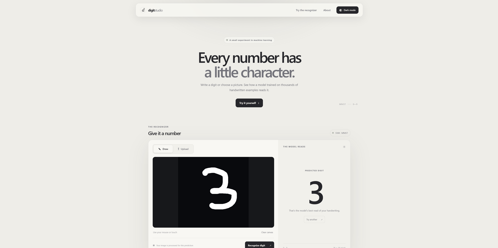
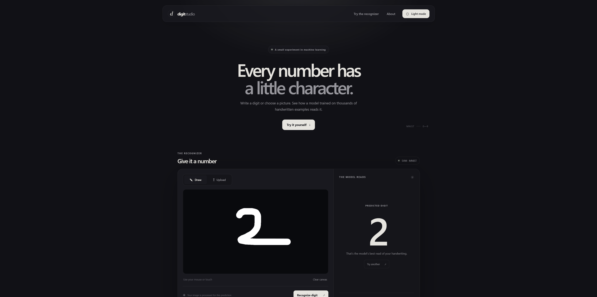

# Digit Studio

A handwritten digit recognition demo built with React, Flask, and Kaggle's Digit Recognizer MNIST data. Draw a digit with a mouse or touch screen, or upload an image, and let the trained SVM model make a prediction.
## Screenshots

| Light theme | Dark theme |
|---|---|
|  |  |

## Project layout

```text
Handwritten Digit Classification/
├── backend/
│   ├── app.py
│   ├── requirements.txt
│   └── models/
│       └── mnist_svm.joblib       # trained model required by the API
├── frontend/
│   ├── index.html
│   ├── package.json
│   ├── package-lock.json
│   ├── vite.config.js
│   └── src/
│       ├── App.jsx
│       ├── main.jsx
│       ├── styles.css
│       └── components/            # loading animation
├── outputs/                       # command-line training/comparison scripts
├── data/                          # local Kaggle CSV files; excluded from Git
├── Dockerfile
├── render.yaml
└── README.md
```

## Run locally on Windows

Open two PowerShell windows in the project folder. You do not need to activate a virtual environment, so this also works when PowerShell blocks `.ps1` scripts.

### 1. Install Python dependencies and start the API

```powershell
py -m venv .venv
.\.venv\Scripts\python.exe -m pip install -r .\backend\requirements.txt
.\.venv\Scripts\python.exe -m flask --app .\backend\app.py run --port 5000
```

Keep this window open.

### 2. Install frontend dependencies and start the website

In the second window:

```powershell
cd .\frontend
npm.cmd install
npm.cmd run dev
```

Open the local URL Vite prints, usually `http://localhost:5173`. The Vite development server forwards `/api` requests to the Flask API.

The npm scripts call Vite through Node directly, which avoids a Windows path-resolution issue when the project folder contains spaces.

## Build and run as one app

```powershell
cd .\frontend
npm.cmd install
npm.cmd run build
cd ..
.\.venv\Scripts\python.exe -m flask --app .\backend\app.py run --port 5000
```

Open `http://127.0.0.1:5000`. Flask serves the built frontend and prediction API from one address.

## Push to GitHub

Install Git for Windows, create an empty repository on GitHub, then open PowerShell in this project folder and run (replace the URL with your repository's URL):

```powershell
git init -b main
git add .
git status --short
git commit -m "Add Digit Studio handwritten digit app"
git remote add origin https://github.com/YOUR-NAME/YOUR-REPOSITORY.git
git push -u origin main
```

Review `git status --short` before committing. The `.gitignore` excludes Kaggle CSVs, generated submissions, virtual environments, and frontend build/dependency folders. It keeps `backend/models/mnist_svm.joblib`, which the website needs to make predictions.

The model file is about 59 MB. GitHub allows command-line pushes of files this size, but Git may show a warning above 50 MiB. It is below GitHub's 100 MiB regular-file limit. Do not upload this file through the GitHub website, which has a smaller per-file upload limit. [GitHub large-file guidance](https://docs.github.com/en/repositories/working-with-files/managing-large-files/about-large-files-on-github).

## Publish it for friends

The included `render.yaml` and `Dockerfile` describe a Render web service that builds the frontend and runs the Flask API together. After pushing to GitHub, connect the repository in Render and deploy it.

This is a demonstration, not general handwriting OCR. Upload one clear digit at a time; images with a plain background work best. Images are sent to the API for prediction and are not saved by this app.

## Model details

The SVM was trained using Kaggle Digit Recognizer `train.csv`. Image preprocessing estimates the background from the image border, isolates the digit, scales it into an MNIST-like 20×20 area on a 28×28 canvas, and centers the ink before prediction. The loading indicator is adapted from the supplied ThoughtLine component and respects reduced-motion preferences.